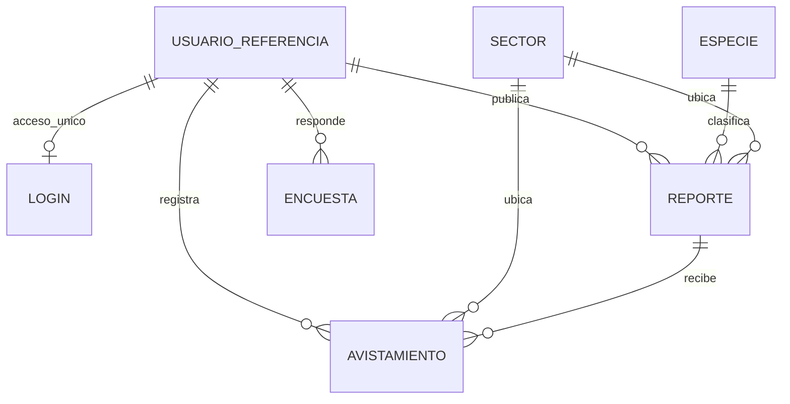

# Fase 1 — Base de datos

El archivo `database/001_schema.sql` crea siete tablas en la base seleccionada. Usa InnoDB, UTF-8, claves foráneas, restricciones e índices. No ejecuta DROP ni crea contraseñas.

| Tabla | Responsabilidad |
|---|---|
| usuario_referencia | Referencia opaca a la identidad validada de la plataforma. Sin correo, nombre ni credenciales. Collation binaria para no confundir identificadores por mayúsculas. |
| login | Perfil local del acceso único: usuario_id, emisor, nombre_usuario, nombre_visible, primer_acceso y ultimo_acceso. Sin contraseña ni token. |
| especie | Catálogo con Bovino, Canino, Equino, Felino, Porcino, Ovino, Caprino, Ave y Otro. |
| sector | Catálogo geográfico. Valores iniciales tomados de los mockups, pendientes de validación comunitaria. |
| reporte | Animal, autor, señas, ubicación, pérdida, estado, versión de edición y foto. |
| avistamiento | Reporte, identidad del observador, sector, fecha y observación. |
| encuesta | Cinco respuestas, identidad, subproyecto y versión; unicidad por persona/subproyecto/versión. |



`usuario_referencia` es una tabla local de referencias, no una réplica del sistema de acceso. Su clave se obtiene del `sub` del JWT verificado; no se realiza una FK entre bases independientes. No se crea la tabla OPERACION_SINCRONIZADA porque no se implementa el flujo offline.

`login.usuario_id` es una PK y FK local a usuario_referencia; cada persona tiene como máximo un perfil de acceso. El nombre de usuario es un dato visible, no una clave para unir reportes: aunque cambie el nombre, el identificador central conserva la autoría. El emisor se fija en el primer acceso y se rechaza reutilizar ese identificador desde un emisor distinto. Una migración de emisor requiere un procedimiento administrativo acordado.

Para actualizar la versión anterior, ejecuta **solo** `database/002_login_unico.sql` con la base seleccionada. Es aditiva y admite repetición; no copia credenciales de otras bases ni modifica registros de reportes. Se verificó sobre la base local conservando su reporte existente.

## Inicializar manualmente

En MySQL Workbench, conectado con una cuenta administrativa:

```sql
CREATE DATABASE rastro_rural CHARACTER SET utf8mb4 COLLATE utf8mb4_unicode_ci;
CREATE USER 'rastro'@'localhost' IDENTIFIED BY 'REEMPLAZA_CON_UNA_CLAVE_ALEATORIA';
GRANT SELECT, INSERT, UPDATE ON rastro_rural.* TO 'rastro'@'localhost';
USE rastro_rural;
```

Abre `database/001_schema.sql` en Workbench, selecciona `rastro_rural` como esquema y ejecuta el script con la cuenta administrativa. La cuenta de aplicación no necesita CREATE, DROP ni privilegios globales. Si MySQL está en otra máquina, ajusta el host permitido a la IP del servidor de aplicación y habilita TLS.

Con consola MySQL también puedes ejecutar:

```text
mysql -u root -p
mysql> USE rastro_rural;
mysql> SOURCE C:/ruta/rastro-rural/database/001_schema.sql;
```

En Docker la imagen crea la base y el usuario, y aplica el SQL al primer arranque. Su usuario inicial tiene permisos completos sobre esa base; reduce a SELECT/INSERT/UPDATE antes de producción (ver despliegue).

## Reglas

- BUSCANDO pasa únicamente a ENCONTRADO o CANCELADO. No se reabre un reporte cerrado.
- La edición y los cambios de estado exigen autoría y la versión leída. Se bloquea la fila en la transacción para evitar perder cambios concurrentes.
- Solo se añaden avistamientos a reportes activos. La fecha no puede ser futura ni anterior a la pérdida.
- Cambiar la fecha de pérdida no puede dejar avistamientos anteriores a esa fecha.
- Se valida en Java que Otro tenga nombre alternativo y que los catálogos existan.
- Fotografías: entrada JPEG/PNG de hasta 2 MB y 16 megapíxeles. Se recodifican para quitar EXIF; resultado máximo de 3 MB. Se guardan en MEDIUMBLOB para que datos y foto compartan transacción y respaldo.
- Un BLOB simplifica el MVP; a gran escala conviene almacenamiento de objetos, con política de acceso y respaldo equivalente.
- Las fechas del animal son civiles de Bogotá; `creado_en` es TIMESTAMP. Configura la conexión con `connectionTimeZone=-05:00&forceConnectionTimeZoneToSession=true` para evitar depender de las tablas de zonas horarias de MySQL.

## Evolución

No vuelvas a ejecutar el script inicial en una base poblada. Para cambios futuros crea `002_*.sql`, pruébalo sobre una restauración y respalda antes de aplicarlo. Los catálogos se amplían mediante INSERT sin alterar las tablas centrales.
